# 📧 Mailora | E-Posta Yönetim Sistemi

Mailora, kullanıcıların e-posta gönderebildiği ve mesajlarını kişisel posta kutuları üzerinden yönetebildiği bir web uygulamasıdır. Kayıt ve hesap işlemleri ASP.NET Core Identity ile yürütülür. Mesajlar, kategoriler ve taslaklar SQL Server’da saklanır. Dashboard, bu verileri sayaçlar ve grafiklerle özetler.

Proje, **M&Y Yazılım Eğitim Akademi Danışmanlık 12. Dönem Bootcamp** kapsamında verilen Mailora temasının dinamik bir uygulamaya dönüştürülmesiyle geliştirilmiştir.

## ✨ Sayfalar ve Özellikler

| Sayfa | Özellikler |
| --- | --- |
| **Kayıt Ol** | Identity ile kullanıcı hesabı oluşturulur ve e-posta adresine 6 haneli doğrulama kodu gönderilir. |
| **E-Posta Doğrulama** | Kod ve geçerlilik süresi kontrol edilir. Süresi dolan kod için yeni kod istenebilir. |
| **Giriş Yap** | Doğrulanmış hesaplar giriş yapabilir. Kullanıcı üst menüden oturumunu kapatabilir. |
| **Şifremi Unuttum** | E-posta adresine süreli ve tek kullanımlık şifre sıfırlama bağlantısı gönderilir. |
| **Şifre Yenileme** | Geçerli bağlantıyla yeni şifre belirlenir. Geçersiz veya süresi dolmuş bağlantılar reddedilir. |
| **Dashboard** | Gelen, gönderilen, okunan, okunmamış, yıldızlı ve taslak mesaj sayıları veritabanından hesaplanır. Son mesajlar, kategori dağılımı, 28 günlük mesaj yoğunluğu ve okunmamış mesajların bekleme süresi gösterilir. |
| **Gelen Kutusu** | Kullanıcıya gelen mesajlar listelenir. Gönderen, konu veya içerikle arama yapılabilir. Mesajlar kategoriye göre filtrelenebilir ve tarihe göre sıralanabilir. Okundu bilgisi ve yıldız durumu değiştirilebilir. |
| **Mesaj Detayı** | Mesajın konusu, içeriği, tarih ve adres bilgileri gösterilir. Gelen mesaj yanıtlanabilir veya başka bir e-posta adresine iletilebilir. |
| **Yeni Mesaj** | Alıcı, konu ve içerik doğrulanır. Gönderen adresi oturum açan hesaptan alınır. Kategoriler veritabanından yüklenir. Kayıtlı kullanıcılar arasındaki mesajlar ilgili posta kutularında görünür. SMTP üzerinden harici adreslere de mesaj gönderilebilir. |
| **Gönderilenler** | Kullanıcının gönderdiği mesajlar listelenir. Mesajlar aranabilir, sıralanabilir, yıldızlanabilir ve Çöp Kutusu’na taşınabilir. |
| **Yıldızlı Mesajlar** | Gelen ve gönderilen yıldızlı mesajlar tek listede görüntülenir. Yıldız kaldırıldığında veya mesaj çöpe taşındığında liste ve sayaç güncellenir. |
| **Taslaklar** | Yarım kalan mesajlar kaydedilebilir ve yeniden düzenlenebilir. Tekrar kaydedildiğinde mevcut taslak güncellenir. Başarıyla gönderilen taslak listeden kalkar. Taslaklarda arama, sıralama, sayfalama ve toplu silme bulunur. |
| **Çöp Kutusu** | Gelen Kutusu ve Gönderilenler’den taşınan mesajlar listelenir. **Geri al** mesajı eski kutusuna döndürür. **Sil** işlemi onaydan sonra mesajı kullanıcının kendi kutusundan kalıcı olarak kaldırır. Alıcı ve gönderenin silme durumları ayrı tutulur. |
| **Profilim** | Ad, soyad, kullanıcı adı, telefon, Hakkımda ve profil fotoğrafı güncellenebilir. Seçilen fotoğraf kaydetmeden önce önizlenebilir. Üst menü oturum açan kullanıcının profil bilgilerini gösterir. |
| **Ayarlar** | Kullanıcı mevcut şifresini doğrulayarak şifresini değiştirebilir. |
| **Hata Ekranları** | Oturum gerektiren, erişimi engellenen ve bulunamayan sayfalar için Mailora temasına uygun 401, 403 ve 404 ekranları bulunur. |

## 🧰 Kullanılan Teknolojiler

| Teknoloji | Projedeki görevi |
| --- | --- |
| **C# ve .NET 9** | Sunucu tarafı uygulama geliştirme |
| **ASP.NET Core MVC ve Razor** | İsteklerin işlenmesi ve dinamik arayüzlerin oluşturulması |
| **ASP.NET Core Identity** | Üyelik, oturum yönetimi, hesap doğrulama ve şifre işlemleri |
| **Entity Framework Core 9 ve SQL Server** | Veritabanı sorguları, kayıt işlemleri ve migration yönetimi |
| **MailKit ve SMTP** | E-posta doğrulama kodu, şifre sıfırlama bağlantısı ve mesaj gönderimi |
| **Bootstrap, Bootstrap Icons, CSS ve JavaScript** | Mailora arayüzü, simgeler ve etkileşimli bileşenler |

## 🏗️ Proje Yapısı

| Klasör | İçerik |
| --- | --- |
| `Controllers` | Üyelik, mesaj yönetimi, profil, ayarlar ve Dashboard işlemleri |
| `Entities` | Kullanıcı, mesaj, taslak ve kategori sınıfları |
| `Models` | Formlar ve sayfalar için ViewModel sınıfları |
| `Context` ve `Migrations` | SQL Server bağlantısı ve veritabanı şeması |
| `Views` ve `ViewComponents` | Razor ekranları ve ortak arayüz bileşenleri |
| `wwwroot` | CSS, JavaScript ve diğer statik dosyalar |

## 📸 Ekran Görüntüleri

### Kayıt Ol

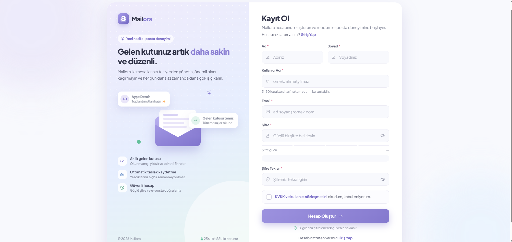

### Giriş Yap

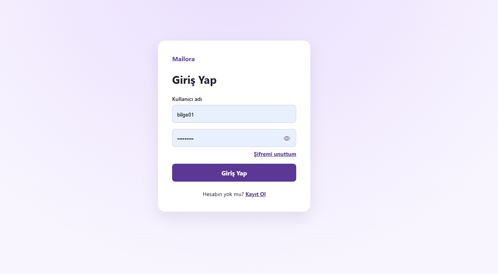

### Şifremi Unuttum

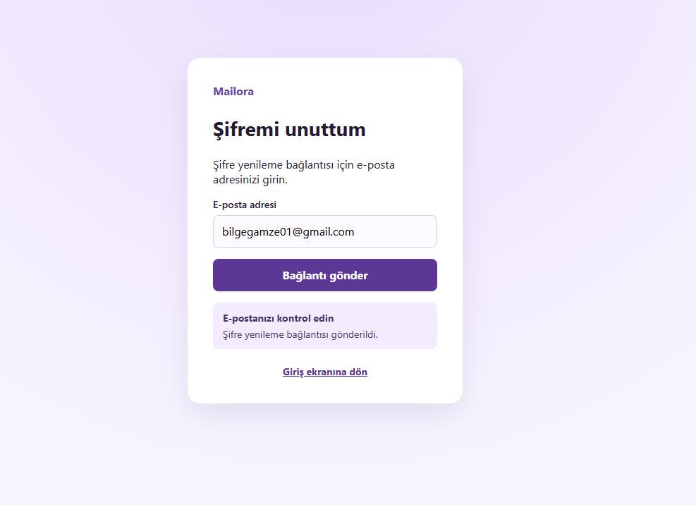

### Şifre Yenileme

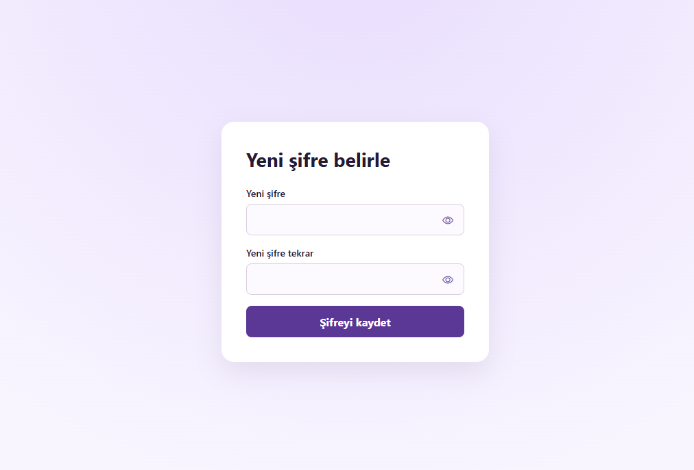

### E-Posta Doğrulama

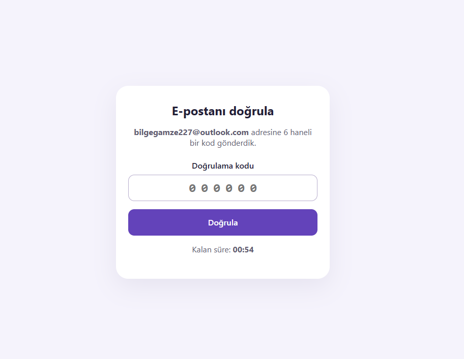

### Dashboard

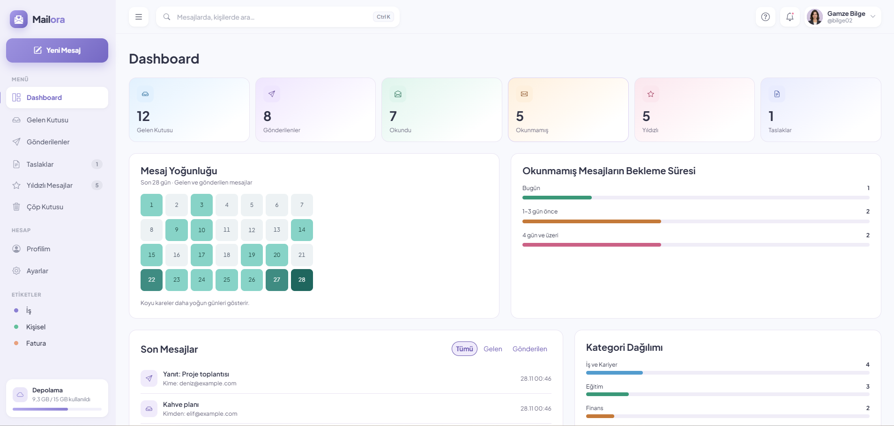

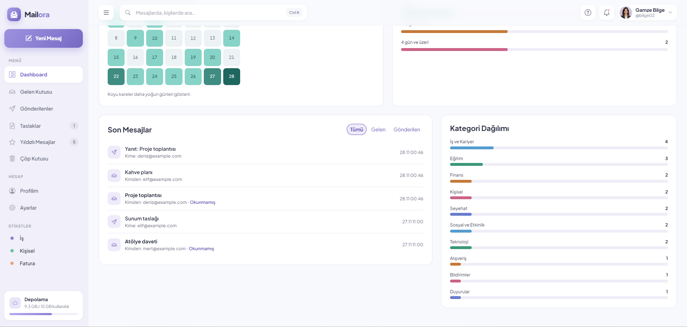

### Gelen Kutusu

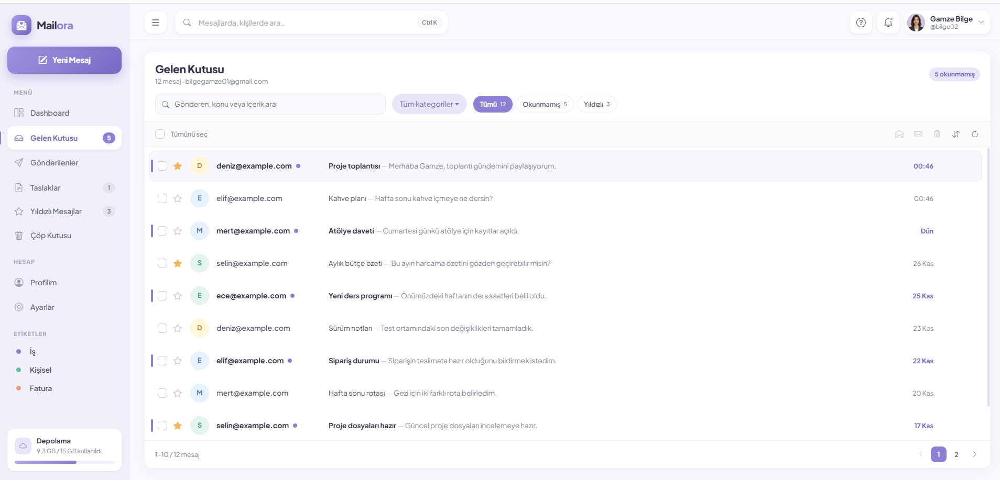

### Yeni Mesaj

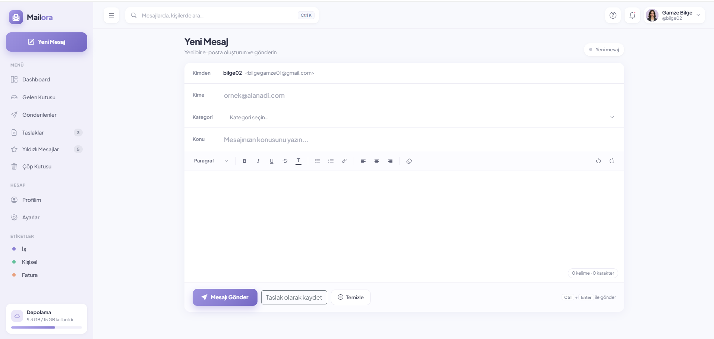

### Gönderilenler

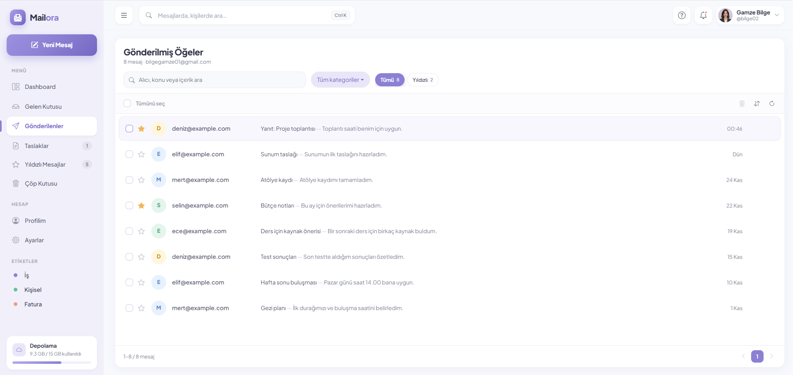

### Yıldızlı Mesajlar

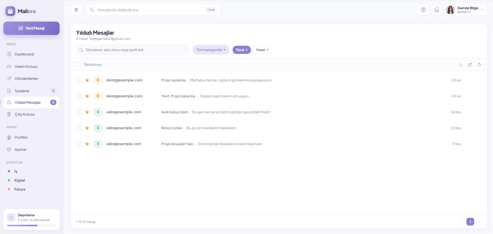

### Taslaklar

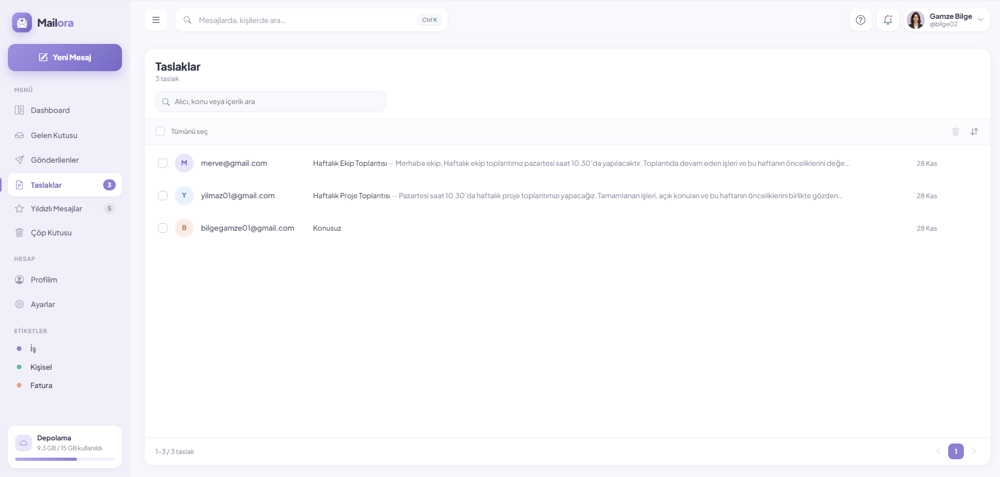

### Çöp Kutusu

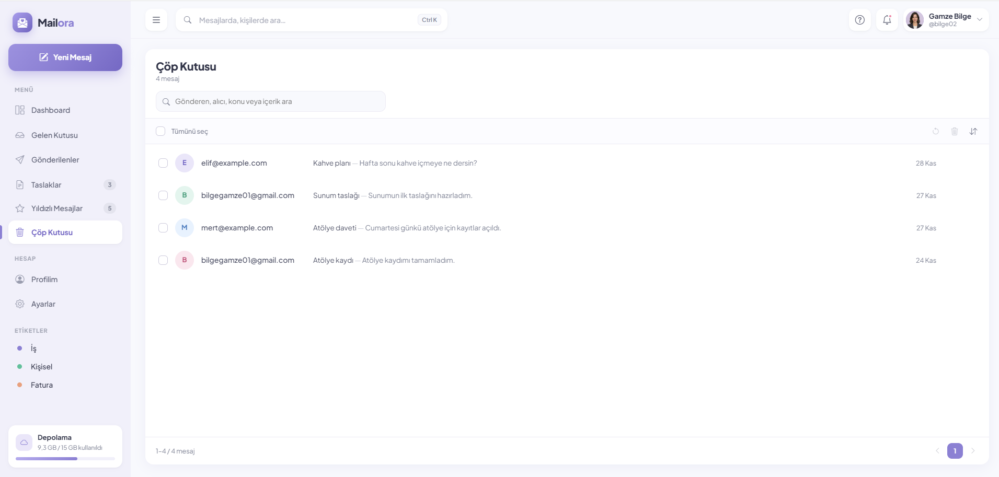

### Profilim

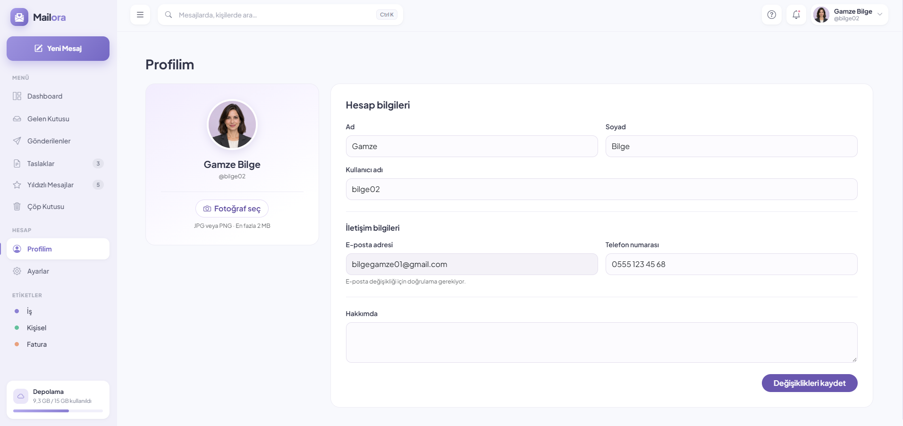

### Ayarlar

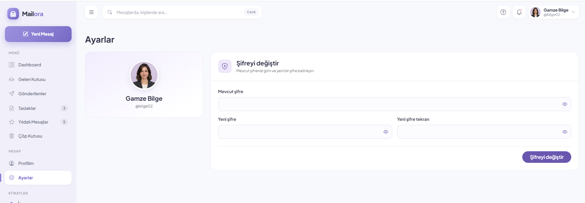

### 401 · Oturum Gerekli

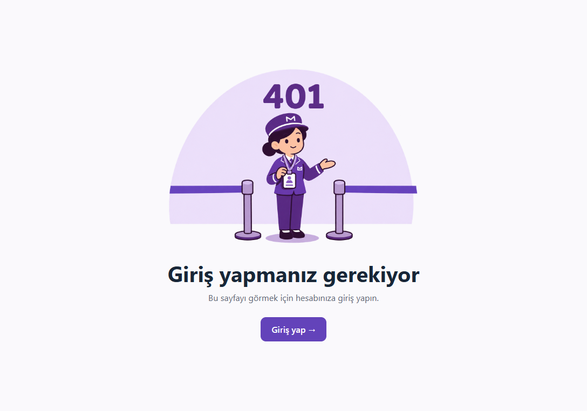

### 403 · Erişim Engellendi


### 404 · Sayfa Bulunamadı

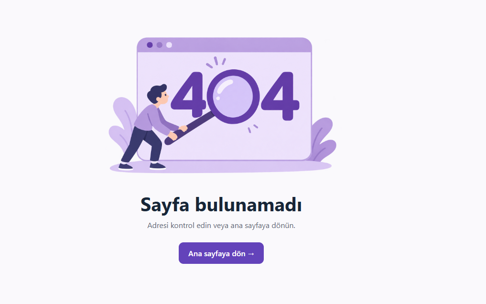

## ⚙️ Kurulum ve Çalıştırma

**Gereksinimler**  
.NET 9 SDK, SQL Server ve aşağıdaki migration adımları için Visual Studio.

1. Depoyu klonlayın ve `MYAcedemy_IdentityEmailProject.sln` dosyasını Visual Studio’da açın.

   ```powershell
   git clone https://github.com/GamzeBilge1/MYAcedemy_IdentityEmailProject.git
   cd MYAcedemy_IdentityEmailProject
   ```

2. `MYAcedemy_IdentityEmailProject/Context/EmailContext.cs` dosyasındaki bağlantı dizesini kendi SQL Server örneğinize göre güncelleyin. Yerel SQL Server Express için örnek bağlantı:

   ```csharp
   optionsBuilder.UseSqlServer(
       @"Server=.\SQLEXPRESS;Database=IdentityEmailDb;Integrated Security=True;TrustServerCertificate=True");
   ```

3. Visual Studio’da **Package Manager Console**’u açın. **Default project** olarak uygulama projesini seçin ve mevcut migration’ları uygulayın.

   ```powershell
   Update-Database
   ```

   Yeni kurulumda `Categories` tablosu boşsa örnek kategori kayıtları ekleyin.

   ```sql
   INSERT INTO dbo.Categories (CategoryName)
   VALUES (N'İş ve Kariyer'), (N'Kişisel'), (N'Duyurular'), (N'Teknoloji');
   ```

4. Mesaj gönderimi ve şifre sıfırlama için SMTP bilgilerini depo kökünden **User Secrets** ile tanımlayın.

   ```powershell
   dotnet user-secrets set "Smtp:Email" "<gönderen-adresi>" --project MYAcedemy_IdentityEmailProject
   dotnet user-secrets set "Smtp:Password" "<uygulama-şifresi>" --project MYAcedemy_IdentityEmailProject
   ```

   Kayıt doğrulamasında kendi SMTP hesabınızı kullanmak için `RegisterController` içindeki gönderim kodunu da bu ayarları okuyacak şekilde yapılandırın.

5. Uygulamayı Visual Studio’da **F5** ile veya depo kökünden aşağıdaki komutla başlatın.

   ```powershell
   dotnet run --project MYAcedemy_IdentityEmailProject
   ```

## 👩‍💻 Geliştirici

**Gamze Bilge**  
[GitHub](https://github.com/GamzeBilge1) · [LinkedIn](https://www.linkedin.com/in/gamze-bilge1/)
